# rn-smart-grid

Flexbox-first layout primitives (`Row`, `Column`, `Grid`, `GridItem`, `Spacer`) and a data-driven
`SmartGrid` for React Native. Works with Expo and react-native-web.

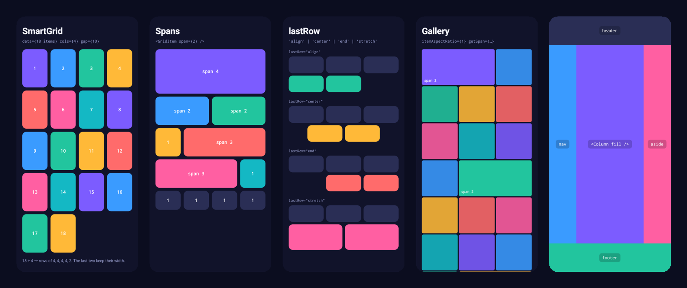

- **No percentage math, no measuring.** Cells grow by their span inside flex rows; flexbox splits the space.
- **Native gaps.** Uses `gap` / `rowGap` / `columnGap` (RN ≥ 0.71), with an opt-in margin fallback.
- **Aligned last rows.** An incomplete last row is padded with invisible placeholders so its items keep
  the same width as the rows above, or it can stretch, center or align to the end.
- **Spans and offsets.** Items can span several columns; rows are packed by total span.
- **Responsive.** `cols={{ base: 2, md: 4, lg: 6 }}`, with configurable breakpoints.
- **Virtualization.** `virtualized` renders rows through a `FlatList`.
- **No runtime dependencies.** Only `react` and `react-native` peer dependencies. Fully typed and tree-shakeable.

## Installation

```sh
npm install rn-smart-grid
# or
yarn add rn-smart-grid
```

Peer dependencies: `react >= 18`, `react-native >= 0.71` (or `react-native-web`). On React Native
below 0.71, which has no `gap` style support, set `<LayoutProvider gapStrategy="margin">`.

## Quick start

```tsx
import { SmartGrid } from 'rn-smart-grid';

<SmartGrid
  data={products}
  cols={4}
  gap={12}
  keyExtractor={(item) => item.id}
  renderItem={({ item }) => <ProductCard product={item} />}
/>;
```

With 18 products this renders 5 rows (4, 4, 4, 4, 2). The 2 items in the last row are exactly as wide
as the items above them.

## Showcase

Every screenshot below is a real screen from the [example app](example/Showcase.tsx), captured on an
Android phone. The code under each one is what produces it (colors and labels left out).

### Row and Column

<table>
<tr>
<td align="center" width="25%"><br /><b>Two columns</b></td>
<td align="center" width="25%">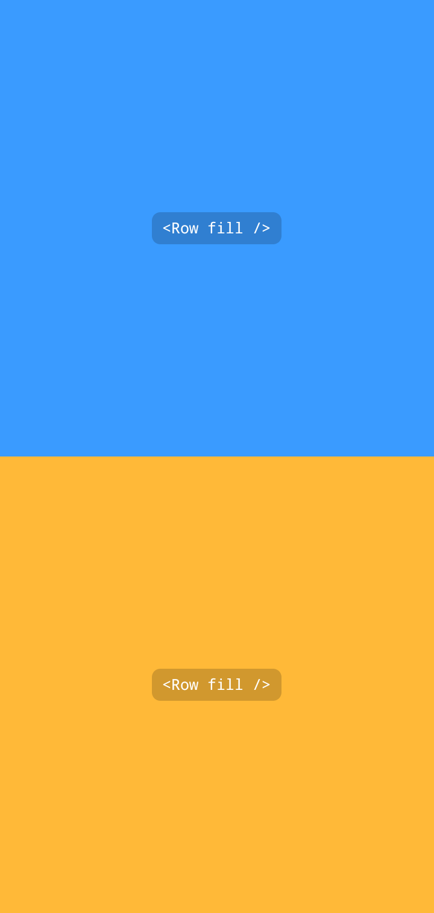<br /><b>Two rows</b></td>
<td align="center" width="25%"><br /><b>Three columns</b></td>
<td align="center" width="25%">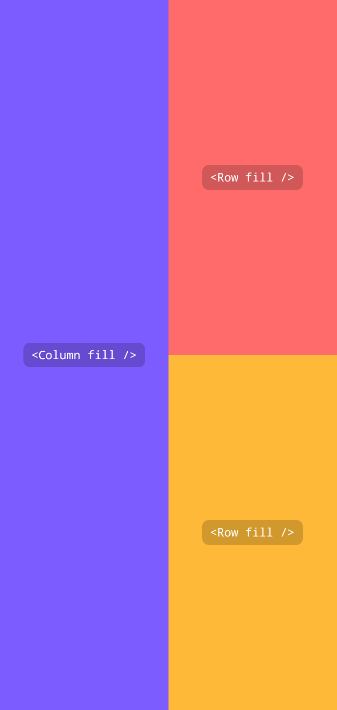<br /><b>Split</b></td>
</tr>
<tr>
<td valign="top">

```tsx
<Row fill>
  <Column fill />
  <Column fill />
</Row>
```

</td>
<td valign="top">

```tsx
<Column fill>
  <Row fill />
  <Row fill />
</Column>
```

</td>
<td valign="top">

```tsx
<Row fill>
  <Column fill />
  <Column fill />
  <Column fill />
</Row>
```

</td>
<td valign="top">

```tsx
<Row fill>
  <Column fill />
  <Column fill>
    <Row fill />
    <Row fill />
  </Column>
</Row>
```

</td>
</tr>
</table>

<table>
<tr>
<td align="center" width="33%">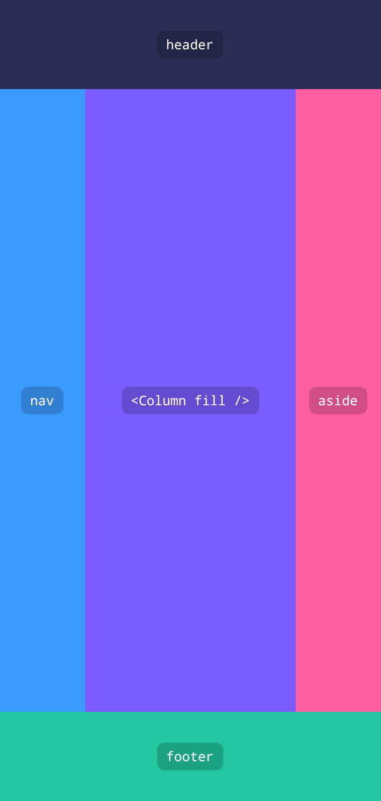<br /><b>Holy grail</b></td>
<td align="center" width="33%">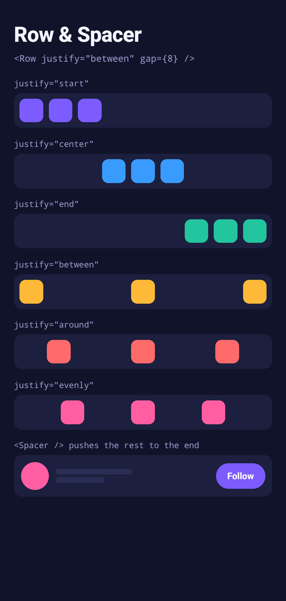<br /><b>justify & Spacer</b></td>
<td valign="top">

```tsx
// Holy grail
<Column fill>
  <Row style={{ height: 96 }} />
  <Row fill>
    <Column style={{ width: 92 }} />
    <Column fill />
    <Column style={{ width: 92 }} />
  </Row>
  <Row style={{ height: 96 }} />
</Column>

// justify & Spacer
<Row justify="between" gap={8} padding={8}>
  …
</Row>

<Row align="center" gap={10}>
  <Avatar />
  <Name />
  <Spacer />
  <FollowButton />
</Row>
```

</td>
</tr>
</table>

### SmartGrid

<table>
<tr>
<td align="center" width="33%">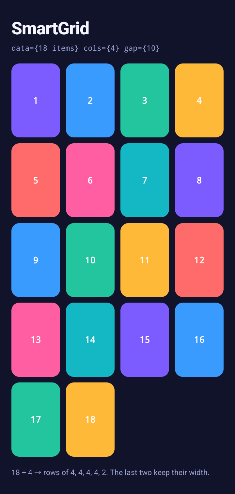<br /><b>18 items, 4 columns</b></td>
<td align="center" width="33%">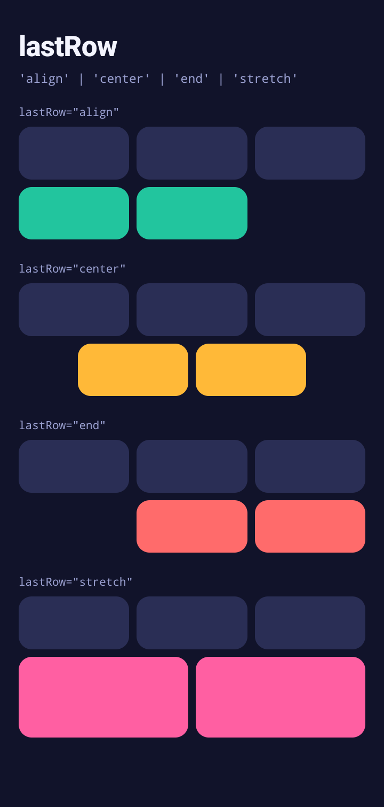<br /><b>lastRow modes</b></td>
<td align="center" width="33%">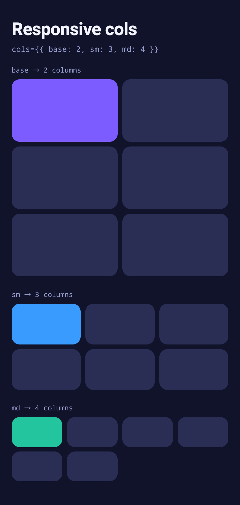<br /><b>Responsive cols</b></td>
</tr>
<tr>
<td valign="top">

```tsx
<SmartGrid
  data={items} // 18
  cols={4}
  gap={10}
  itemAspectRatio={0.66}
  renderItem={({ item }) => (
    <Tile item={item} />
  )}
/>
```

</td>
<td valign="top">

```tsx
<SmartGrid
  data={items} // 5
  cols={3}
  gap={8}
  lastRow="center"
  // or "align" | "end" | "stretch"
  renderItem={renderTile}
/>
```

</td>
<td valign="top">

```tsx
<SmartGrid
  data={items}
  cols={{ base: 2, sm: 3, md: 4 }}
  gap={8}
  renderItem={renderTile}
/>
```

</td>
</tr>
</table>

### Spans, offsets and galleries

<table>
<tr>
<td align="center" width="33%">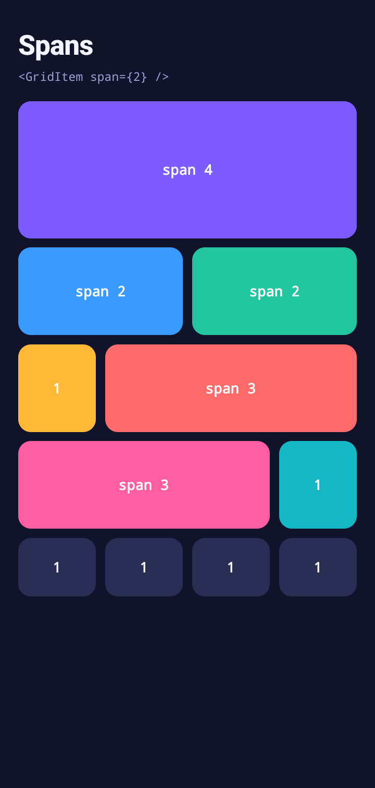<br /><b>Spans</b></td>
<td align="center" width="33%">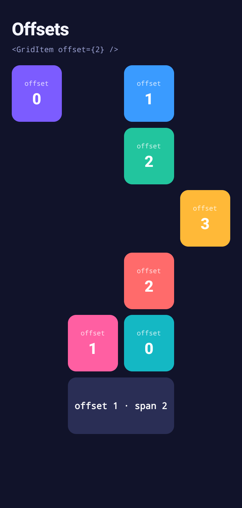<br /><b>Offsets</b></td>
<td align="center" width="33%">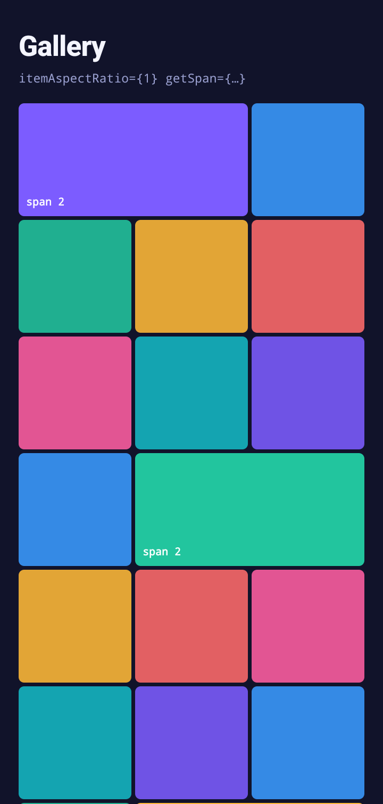<br /><b>Gallery</b></td>
</tr>
<tr>
<td valign="top">

```tsx
<Grid cols={4} gap={10}>
  <GridItem span={4} />
  <GridItem span={2} />
  <GridItem span={2} />
  <GridItem />
  <GridItem span={3} />
  <GridItem span={3} />
  <GridItem />
</Grid>
```

</td>
<td valign="top">

```tsx
<Grid cols={4} gap={10}>
  <GridItem offset={0} />
  <GridItem offset={1} />
  <GridItem offset={2} />
  <GridItem offset={3} />
  …
  <GridItem offset={1} span={2} />
</Grid>
```

</td>
<td valign="top">

```tsx
<SmartGrid
  data={photos}
  cols={3}
  gap={4}
  itemAspectRatio={1}
  getSpan={(p) => (p.featured ? 2 : 1)}
  renderItem={renderPhoto}
/>
```

</td>
</tr>
</table>

## How it works

### Rows of flex cells

`SmartGrid` and `Grid` split their items into rows. Each row is a `flexDirection: 'row'` view with
`columnGap`. Each cell gets:

```ts
{ flexGrow: span, flexShrink: 1, flexBasis: (span - 1) * columnGap, minWidth: 0 }
```

A span-1 cell is `flex: 1`. For wider cells, `flexBasis` adds back the gaps the cell covers. Every
full row then has the same free space, `width − (cols − 1) × gap`, so a span-N cell is exactly N
columns plus the N − 1 gaps between them. Columns line up across rows without any measurement or
percentages.

### Packing algorithm

`packRows(data, cols, getSpan?, getOffset?)` walks the items once, in order:

1. `span` is clamped to `[1, cols]` and `offset` to `[0, cols − span]`.
2. If `offset + span` does not fit in what is left of the current row, the row is closed and the item
   starts a new one.
3. The item is placed at column `used + offset`, and `used` grows by `offset + span`.
4. A row closes as soon as `used === cols`.

Without `getSpan` this is the same as `chunk(data, cols)`, which is used directly as a fast path. The
algorithm keeps item order and does not backfill earlier holes.

### Last-row placeholders

`layoutRow(row, cols, isLastRow, lastRow, getKey)` turns a packed row into the children to render.
When a row uses fewer than `cols` columns, it adds placeholder views with the same flex style as a
cell of the missing span (`flexGrow: remaining`). They have no content, `pointerEvents: 'none'`, and
are hidden from accessibility (`accessible={false}`, `accessibilityElementsHidden`,
`importantForAccessibility="no-hide-descendants"`, `aria-hidden`).

| `lastRow`         | Placeholders                         | Result                               |
| ----------------- | ------------------------------------ | ------------------------------------ |
| `align` (default) | one at the end                       | equal-width items at the start       |
| `stretch`         | none                                 | items share the full width           |
| `center`          | half the remainder on each side      | equal-width items, centered          |
| `end`             | one at the start                     | equal-width items at the end         |

An odd remainder with `center` uses two half-column placeholders. Their missing basis is applied
as a negative margin on the row's outer edge, so centering is exact. Rows that are not the last one
but are incomplete (because the next item's span did not fit) are always padded with `align`. Offsets
render as leading placeholders.

Start and end are logical (`marginStart`, flex order), so everything mirrors under RTL
(`I18nManager.isRTL`) with no extra code.

## Components

### `SmartGrid<T>`

| Prop                    | Type                                                     | Default            | Description                                                                         |
| ----------------------- | -------------------------------------------------------- | ------------------ | ----------------------------------------------------------------------------------- |
| `data`                  | `readonly T[]`                                           | required           | Items to lay out.                                                                   |
| `cols`                  | `number \| ResponsiveValue<number>`                      | required           | Column count. Invalid values (≤ 0, `NaN`) become 1 and fractions are floored, with a dev warning. |
| `renderItem`            | `({ item, index, row, col }) => ReactNode`               | required           | Renders a cell's content. `col` is the cell's starting column.                      |
| `keyExtractor`          | `(item: T, index: number) => string`                     | `key`, `id`, index | Stable cell keys.                                                                   |
| `gap`                   | `number`                                                 | `0`                | Space between rows and columns.                                                     |
| `rowGap`                | `number`                                                 | `gap`              | Space between rows.                                                                 |
| `columnGap`             | `number`                                                 | `gap`              | Space between columns.                                                              |
| `getSpan`               | `(item: T, index: number) => number`                     | none               | Columns an item spans. Clamped to `cols`. Rows are packed by total span.            |
| `itemAspectRatio`       | `number`                                                 | none               | `aspectRatio` (width / height) of one column. Wider cells stretch to the row height; a row of only wide cells uses `ratio × span`. |
| `align`                 | `'start' \| 'center' \| 'end' \| 'stretch'`              | `'stretch'`        | Vertical alignment of cells in a row.                                               |
| `lastRow`               | `'align' \| 'stretch' \| 'center' \| 'end'`              | `'align'`          | How an incomplete last row is laid out.                                             |
| `virtualized`           | `boolean`                                                | `false`            | Render rows through a `FlatList`. If false, renders a plain `View` that can sit inside a `ScrollView`. |
| `rowHeight`             | `number`                                                 | none               | Fixed row height, excluding the row gap. Enables `getItemLayout` when virtualized.  |
| `style`                 | `StyleProp<ViewStyle>`                                   | none               | Container style (the `FlatList` style when virtualized).                            |
| `rowStyle`              | `StyleProp<ViewStyle>`                                   | none               | Style for each row.                                                                 |
| `cellStyle`             | `StyleProp<ViewStyle> \| ({ index, row, col }) => StyleProp<ViewStyle>` | none | Style for each cell, applied to a view inside the sizing view so padding and borders never shift columns. |
| `testID`                | `string`                                                 | none               | Also derives `${testID}-row-N`, `${testID}-cell-N` and `${testID}-placeholder-…`.   |
| `ListEmptyComponent`    | `ComponentType \| ReactElement`                          | none               | Shown for empty `data`, virtualized or not. Without it, an empty grid renders nothing. |
| `ListHeaderComponent`   | `ComponentType \| ReactElement`                          | none               | Virtualized only.                                                                   |
| `ListFooterComponent`   | `ComponentType \| ReactElement`                          | none               | Virtualized only.                                                                   |
| `onEndReached`          | `FlatList['onEndReached']`                               | none               | Virtualized only.                                                                   |
| `onEndReachedThreshold` | `number`                                                 | none               | Virtualized only.                                                                   |
| `refreshControl`        | `ReactElement<RefreshControlProps>`                      | none               | Virtualized only.                                                                   |
| `contentContainerStyle` | `StyleProp<ViewStyle>`                                   | none               | Virtualized only.                                                                   |
| `scrollEnabled`         | `boolean`                                                | none               | Virtualized only.                                                                   |
| `initialNumToRender`    | `number`                                                 | `8` rows           | Virtualized only.                                                                   |
| `maxToRenderPerBatch`   | `number`                                                 | `8` rows           | Virtualized only.                                                                   |
| `windowSize`            | `number`                                                 | `7`                | Virtualized only.                                                                   |
| `flatListProps`         | `Partial<FlatListProps<PackedRow<T>>>`                   | none               | Any other FlatList prop. Explicit props above take precedence.                      |
| `listRef`               | `Ref<FlatList<PackedRow<T>>>`                            | none               | Ref to the underlying `FlatList`.                                                   |

In virtualized mode each list item is one row, with key `row-N`. `removeClippedSubviews` defaults to
`true` on Android. The row gap is rendered with `ItemSeparatorComponent`, and `getItemLayout`
returns `{ length: rowHeight, offset: (rowHeight + rowGap) * index }`.

### `Grid` and `GridItem`

Use these for a grid of hand-written children. `Grid` uses the same packing, styles and last-row
logic as `SmartGrid`.

```tsx
<Grid cols={3} gap={8}>
  <GridItem span={2}>…</GridItem>
  <GridItem>…</GridItem>
  <GridItem offset={1}>…</GridItem>
</Grid>
```

| `Grid` prop       | Type                                        | Default     | Description                                      |
| ----------------- | ------------------------------------------- | ----------- | ------------------------------------------------ |
| `cols`            | `number \| ResponsiveValue<number>`         | required    | Column count.                                    |
| `gap`             | `number`                                    | `0`         | Space between rows and columns.                  |
| `rowGap`          | `number`                                    | `gap`       |                                                  |
| `columnGap`       | `number`                                    | `gap`       |                                                  |
| `align`           | `'start' \| 'center' \| 'end' \| 'stretch'` | `'stretch'` | Vertical alignment of cells in a row.            |
| `lastRow`         | `'align' \| 'stretch' \| 'center' \| 'end'` | `'align'`   |                                                  |
| `itemAspectRatio` | `number`                                    | none        | `aspectRatio` of one column (same rules as `SmartGrid`). |
| `rowStyle`        | `StyleProp<ViewStyle>`                      | none        |                                                  |
| `...ViewProps`    |                                             |             | Passed to the container `View`. The ref is forwarded. |

| `GridItem` prop | Type     | Default | Description                                         |
| --------------- | -------- | ------- | --------------------------------------------------- |
| `span`          | `number` | `1`     | Columns to span, clamped to `cols`.                 |
| `offset`        | `number` | `0`     | Empty placeholder columns rendered before the item. |
| `style`         | `StyleProp<ViewStyle>` | none | Cell style (background, padding, border, …). Applied to a view inside the sizing view, so padding never shifts columns. |
| `...ViewProps`  |          |         | Also applied to the cell (`testID`, accessibility props, …). |

Children that are not `GridItem`s take one column. `null`, `false` and other non-element children are
skipped. Outside a `Grid`, a `GridItem` renders as a plain `View`.

### `Row` and `Column`

Thin wrappers over `View` with `flexDirection` preset. They forward refs and accept all `ViewProps`.

| Prop        | Type                                                                    | Description                                      |
| ----------- | ----------------------------------------------------------------------- | ------------------------------------------------ |
| `gap`       | `number`                                                                | `rowGap` and `columnGap`.                        |
| `rowGap`    | `number`                                                                | Overrides `gap`.                                 |
| `columnGap` | `number`                                                                | Overrides `gap`.                                 |
| `align`     | `'start' \| 'center' \| 'end' \| 'stretch' \| 'baseline'`               | `alignItems`.                                    |
| `justify`   | `'start' \| 'center' \| 'end' \| 'between' \| 'around' \| 'evenly'`     | `justifyContent`.                                |
| `wrap`      | `boolean`                                                               | `flexWrap: 'wrap'` (`Row` only).                 |
| `reverse`   | `boolean`                                                               | `row-reverse` / `column-reverse`.                |
| `flex`      | `number`                                                                | `flex`.                                          |
| `fill`      | `boolean`                                                               | `flex: 1`.                                       |
| `padding`   | `number`                                                                | `padding`.                                       |
| `paddingX`  | `number`                                                                | `paddingHorizontal`.                             |
| `paddingY`  | `number`                                                                | `paddingVertical`.                               |

```tsx
<Row align="center" gap={8} paddingX={16}>
  <Avatar />
  <Text>Name</Text>
  <Spacer />
  <Button title="Follow" />
</Row>
```

### `Spacer`

| Prop   | Type     | Description                                                                                        |
| ------ | -------- | -------------------------------------------------------------------------------------------------- |
| `size` | `number` | Fixed size along the parent's main axis: width in a `Row`, height in a `Column` or plain `View`. Omit it for `flex: 1`. |

`Spacer` learns its axis from the nearest `Row` or `Column`. Inside any other parent it assumes a
column.

### `LayoutProvider`

```tsx
<LayoutProvider breakpoints={{ sm: 360, md: 600, lg: 900, xl: 1200 }} spacing={4}>
  <App />
</LayoutProvider>
```

| Prop          | Type                     | Default                                   | Description                                                                 |
| ------------- | ------------------------ | ----------------------------------------- | --------------------------------------------------------------------------- |
| `breakpoints` | `Record<string, number>` | `{ sm: 360, md: 600, lg: 900, xl: 1200 }` | Name to minimum window width. `base` is always active below the smallest breakpoint. |
| `spacing`     | `number`                 | `4`                                       | Spacing unit.                                                               |
| `useScale`    | `boolean`                | `false`                                   | Multiply numeric gap, padding and `Spacer` sizes by `spacing`. If false, values are raw pixels. |
| `gapStrategy` | `'gap' \| 'margin'`      | `'gap'`                                   | `margin` emulates gaps for RN < 0.71: logical start margins in grids and spacer views in `Row`/`Column`. Cross-axis gaps of a wrapping `Row` are not emulated. |

Providers can be nested. A nested provider inherits any prop it does not set.

## Hooks and utilities

| Export                                                | Description                                                                 |
| ----------------------------------------------------- | --------------------------------------------------------------------------- |
| `useBreakpoint(): string`                             | Current breakpoint name, from `useWindowDimensions`.                        |
| `useResponsiveValue(value)`                           | Resolves a responsive value for the current breakpoint.                     |
| `useSpace(): (n) => number`                           | Applies the provider's spacing scale.                                       |
| `useLayoutConfig()`                                   | The active provider configuration.                                          |
| `resolveResponsive(value, breakpoint, breakpoints?)`  | Mobile-first resolution: uses the value for `breakpoint` or the nearest smaller one, falling back to `base`. |
| `getBreakpoint(width, breakpoints?)`                  | Breakpoint name for a width.                                                |
| `chunk(data, size)`                                   | Pure chunking: `chunk([1,2,3,4,5], 2)` returns `[[1,2],[3,4],[5]]`.          |
| `packRows(data, cols, getSpan?, getOffset?)`          | The span-aware packing used by both grids.                                  |
| `layoutRow(row, cols, isLast, lastRow, getKey)`       | Converts a packed row into cells and placeholders.                          |
| `normalizeCols(value)`                                | Column validation used by the grids.                                        |

## Examples

### Responsive gallery

```tsx
<SmartGrid
  data={photos}
  cols={{ base: 2, sm: 3, md: 4, lg: 6 }}
  gap={6}
  itemAspectRatio={1}
  getSpan={(photo) => (photo.featured ? 2 : 1)}
  lastRow="center"
  renderItem={({ item }) => <Image source={{ uri: item.uri }} style={{ flex: 1 }} />}
/>
```

### Large lists

```tsx
<SmartGrid
  virtualized
  data={thousandsOfItems}
  cols={4}
  gap={8}
  rowHeight={72}
  onEndReached={loadMore}
  refreshControl={<RefreshControl refreshing={refreshing} onRefresh={refresh} />}
  ListHeaderComponent={<Header />}
  renderItem={renderCell}
/>
```

A runnable React Native CLI app with a product grid, a responsive gallery, a mixed-span `Grid` and
a 1,000-item virtualized grid is in [`example/`](example/App.tsx). Its Metro config resolves
`rn-smart-grid` to `../src`, so library changes show up with Fast Refresh.

```sh
cd example
npm install
npm start          # Metro, in one terminal
npm run android    # in another terminal, with an emulator or USB device connected
# iOS (macOS only): cd ios && bundle install && bundle exec pod install && cd .. && npm run ios
```

The **Showcase ▸** chip opens the full-screen layouts shown above. Tap to go to the next one and
long-press to leave. To regenerate the README images from a connected Android device (Windows
PowerShell, with Metro and the app running):

```powershell
powershell -ExecutionPolicy Bypass -File example/scripts/capture-showcase.ps1
```

It opens each screen with the `rnsmartgrid://showcase/<n>` deep link, crops away the system bars,
and writes `docs/images/<name>.png`.

## Performance notes

- Packing runs in `useMemo` and reruns only when `data`, the resolved `cols` or `getSpan` changes.
  Pass a stable `getSpan`, for example one declared at module level or with `useCallback`.
- Rows and cells are `React.memo` components that compare row contents. When you append data, only
  the new and changed rows re-render. Keep `renderItem`, `keyExtractor` and `cellStyle` stable with
  `useCallback` or module-level functions to get the full benefit.
- Row keys are positional (`row-N`), so when `cols` changes, cells that stay in the same row index
  keep their mounted state. A cell that moves to another row remounts, because React cannot move an
  element to a new parent.
- Layout styles are created once with `StyleSheet.create` and cached by span and gap. The grid needs
  no `onLayout` measurement.

## Development

```sh
npm install
npm test           # Jest + @testing-library/react-native
npm run typecheck  # tsc, including tests (the example has its own: cd example && npm run typecheck)
npm run build      # tsup, outputs CJS, ESM and .d.ts to dist/
```

## License

MIT
